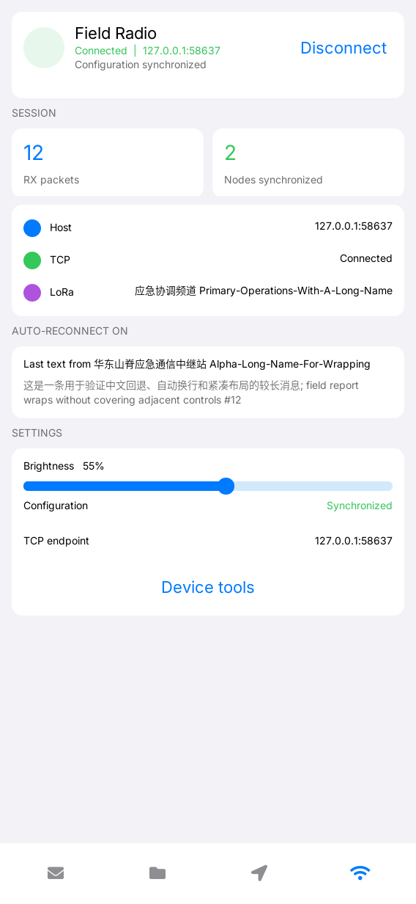

# LILYGO Meshtastic

**English** | [简体中文](README.zh-CN.md)

lilygo-ui-meshtastic is a Meshtastic client for LILYGO UI. It is an independent
C++17 application built with [LILYGO UI AppKit](https://github.com/LILYGO-UI/cm0-appkit)
and LVGL 9.5, and connects to a Meshtastic radio through the TCP Client API
provided by `meshtasticd`. It is packaged as `lilygo-ui-meshtastic` and uses
`cc.lilygo.ui.Meshtastic` for desktop integration.

The project provides a CM0 ARM64 Linux build and an SDL2 desktop simulator for
development and testing. Its feature and interaction scope follows the
Meshtastic Apple client as a reference; no Apple client source is copied into
this repository.

## Preview

<p>
  
</p>

## Features

- **Conversations:** browse channel and private messages, search conversations,
  track unread counts, load history in pages, and keep drafts while navigating
  or rotating the display.
- **Reliable delivery state:** show queued, sent-to-radio, routing ACK,
  rejected, timeout, and failure states. Sending to the transport is separate
  from acknowledgement, and retry is always explicit.
- **Nodes and map:** browse nodes, positions, telemetry, waypoints, and trace
  paths. The built-in OpenStreetMap view supports pan, zoom, address search,
  node selection, node following, and local raster tile caching.
- **Node tools:** request telemetry, trace routes, and create or share editable
  waypoints. Recorded telemetry and trace paths survive application restarts.
- **Device settings:** edit device and module configuration through typed
  fields, preserve fields that are not exposed by the UI, verify writes by
  reading values back from the radio, and confirm destructive operations such
  as restart, shutdown, and NodeDB reset.
- **Channels:** edit channel slots and keys, control uplink/downlink settings,
  and import or export standard Meshtastic ChannelSet URLs with a preview.
- **Persistent local data:** SQLite stores messages, nodes, channels,
  configuration, positions, telemetry, waypoints, and trace replies. Data is
  isolated by TCP endpoint and radio identity.
- **Responsive input:** use the same layout across portrait and landscape
  containers, with physical keyboard support and an LVGL software keyboard when
  no TCA8418 keyboard is available.

New map tiles and address searches require internet access. Previously cached
tiles remain available offline, and mesh messaging does not depend on map
connectivity. See [storage and map behavior](docs/03-storage-and-maps.md) for
cache paths and offline rules.

## Development Environment

Project identity, version, package metadata, permissions, build presets, and
deployment defaults come from [lpm.toml](lpm.toml). CMakePresets.json defines
the host-simulator and cm0-cross configurations. The repository is a top-level
CMake project and consumes the platform SDK only through:

```cmake
find_package(LilyGoUI CONFIG REQUIRED)
```

Run project commands from the repository root.

### Get the Source

```sh
git clone --recurse-submodules https://github.com/LILYGO-UI/meshtastic.git
cd meshtastic
```

For an existing checkout, initialize the pinned AppKit, Meshtastic schema,
Protobuf, and Abseil dependencies:

```sh
git submodule update --init --recursive
```

The presets use the source SDK in third_party/cm0-appkit; a separate AppKit
installation is not required for the simulator. The SDK package builds AppKit
and LVGL as static libraries inside this application. It does not introduce
AppKit or LVGL shared-library dependencies.

### Host Dependencies

Use CMake 3.21 or later, Python 3.11 or later, and a C/C++ compiler with C++17
support. The presets use Unix Makefiles. AppKit requires patch for its LVGL
patches. SDL2 supplies the host display, FreeType renders fonts, json-c parses
service data, SQLite stores application data, and libpng validates cached map
tiles. Runtime HTTP requests use the curl executable, so libcurl development
headers are not required.

#### Debian 12 / Ubuntu 24.04 or Later

```sh
sudo apt update
sudo apt install build-essential cmake git pkg-config patch libsdl2-dev \
  libfreetype6-dev libjson-c-dev libsqlite3-dev libpng-dev curl \
  ca-certificates python3 python3-venv python3-pip
```

Older distributions need CMake and Python upgraded to the minimum versions
above.

#### macOS

Install the Xcode Command Line Tools if needed, then install the dependencies
with [Homebrew](https://brew.sh/):

```sh
xcode-select --install
brew install git cmake pkg-config patch sdl2 freetype json-c sqlite libpng curl python
```

Complete the Homebrew shell setup so its tools and libraries are on PATH.

#### LPM

CMake invokes lpm metadata --format cmake while configuring. Install LPM in a
project-local Python environment:

```sh
python3 -m venv .venv
. .venv/bin/activate
python -m pip install "git+https://github.com/LILYGO-UI/lpm.git"
lpm --version
```

Reactivate the environment in each new terminal before running lpm. CMake
searches .venv/bin as well as PATH. To use another installation, pass
-DLPM_EXECUTABLE=/absolute/path/to/lpm during configuration. Inspect the
metadata generated from lpm.toml with:

```sh
lpm metadata --format publish-json
```

Check the environment before building:

```sh
cmake --version
python --version
pkg-config --modversion sdl2 freetype2 json-c sqlite3 libpng
lpm metadata --format cmake
```

### Device Cross Compiler

Skip this section when building only the desktop simulator. Device builds need
an AArch64 Linux cross compiler on the development machine.

**Debian / Ubuntu:**

```sh
sudo apt install gcc-aarch64-linux-gnu g++-aarch64-linux-gnu
```

**Apple Silicon macOS:**

```sh
brew install aarch64-unknown-linux-gnu
```

The BSP toolchain expects these executable names on PATH:

```sh
aarch64-linux-gnu-gcc --version
aarch64-linux-gnu-g++ --version
```

The BSP supplies target headers and libraries but does not install the host
cross compiler. Cross builds require target development files, including
json-c, FreeType, and DRM, in the sysroot; host libraries cannot replace them.

## Build and Test

Use LPM from the repository root after completing the environment setup. It
reads the presets and package output directory from lpm.toml.

### Desktop Simulator

Start the simulator with the default Meshtastic endpoint, 127.0.0.1:4403:

```sh
lpm start --foreground
```

To reuse an existing build, use lpm start --no-build --foreground. The
underlying executable is:

```sh
./build/host-simulator/lilygo-ui-meshtastic
```

The target board or local service must expose the Meshtastic Client API on TCP
port 4403 and be connected to the radio. Override the endpoint with
application-specific options:

```sh
./build/host-simulator/lilygo-ui-meshtastic \
  --host 192.168.8.222 --port 4403
```

Both --host=value and --port=value are accepted. LPM forwards options after
the separator to the application:

```sh
lpm start --foreground -- --host 192.168.8.222 --port 4403
```

The application reports a configuration sync timeout and reconnects when the
service is unavailable. It has no presentation-mode option; layout responds to
actual LVGL container geometry and is reapplied when the geometry changes.

When no physical TCA8418 keyboard is present, tapping the message composer or
node name field opens the software keyboard. Confirm sends or saves the edit;
cancel keeps a chat draft or restores the previous node name. AppKit owns
physical keyboard discovery, hotplug, focus navigation, and software-keyboard
suppression.

### Tests

Configure and build the host simulator, then run the complete test suite:

```sh
lpm test
```

| Test group | Coverage |
| --- | --- |
| meshtastic-maps | Map projection, tile scheduling, PNG validation, cache behavior, node overlays, and offline operation |
| meshtastic-configuration | Typed device/module edits, preserved protobuf fields, transactions, readback verification, and destructive-operation confirmation |
| meshtastic-channels | Channel slots, keys, uplink/downlink settings, and ChannelSet URL import/export |
| meshtastic-workflows | Reliable send states, ACK/NAK matching, retry behavior, reconnect recovery, and page workflows |
| meshtastic-persistence, meshtastic-client-history | SQLite migrations, endpoint/radio isolation, message history, telemetry, positions, and interrupted-send recovery |
| meshtastic-protobufs, meshtastic-core | Official field encodings, bounded stream framing, generated Protobuf conversion, and loopback TCP handshake |
| meshtastic-view-model, meshtastic-qr | Router/page state transitions, commands, and QR payload generation |
| meshtastic-render-* | Headless UI, settings, channel, map, and search renders at 320 x 568, 568 x 1232, 1232 x 568, and 1024 x 768 |

Render tests write PPM images below build/host-simulator. Inspect the images
after UI changes; passing assertions does not verify visual hierarchy, text
clipping, keyboard behavior, or rotation state. Follow the [UI development
guidelines](docs/01-user-interface.md) for acceptance requirements.

The live smoke test is opt-in and connects to the default endpoint:

```sh
LILYGO_MESHTASTIC_DB_PATH=:memory: \
  build/host-simulator/meshtastic-live-smoke 127.0.0.1 4403
```

### CM0 Device Build

The cm0-cross preset targets CM0 Raspberry Pi OS on AArch64, uses a Release
build, disables host tests, and installs under /usr. Build and package the
application with:

```sh
lpm pack
```

The first lpm pack (or cmake --preset cm0-cross) downloads CM0 BSP 0.1.0,
verifies its pinned SHA-256, and extracts the sysroot to
.cache/cm0-bsp/0.1.0/sysroot. The first download needs GitHub access; later
configurations reuse the cache. Set -DCM0_BSP_CACHE_DIR=/absolute/path/to/cache
to choose another cache location. No sibling CM0BspBuilder checkout is needed.

CPack writes an ARM64 .deb to dist/. The package installs the executable,
Launcher manifest, icon, desktop file, AppStream metadata, third-party notices,
and AppKit font licenses. Its runtime dependency includes
lilygo-ui-appkit-dev >= 0.1.0, as declared by min_appkit_version in lpm.toml.

Deploy the newest package using the SSH destination in lpm.toml:

```sh
lpm deploy
```

<details>
<summary>Underlying CMake commands</summary>

LPM wraps the following commands. LPM is still required to read project
metadata during configuration.

Host build and tests:

```sh
cmake --preset host-simulator
cmake --build --preset host-simulator --parallel
ctest --preset host-simulator --output-on-failure
```

Device build and packaging:

```sh
cmake --preset cm0-cross
cmake --build --preset cm0-cross --parallel
cpack --config build/cm0-cross/CPackConfig.cmake -B dist
```

</details>

### GPU Renderer Builds

Device rendering is selected at application build time by the source AppKit
SDK. Use an updated SDK supporting LILYGO_UI_RENDERER and a target-matched
CM0 sysroot with libgbm-dev, libegl-dev, and libgles-dev. The original pinned
AppKit submodule and BSP 0.1.0 do not provide this GPU configuration.

For an OpenGL ES build, select a newer AppKit checkout explicitly and keep a
separate build directory:

```sh
cmake --preset cm0-cross -B build/cm0-opengles \
  -DLilyGoUI_DIR=/path/to/appkit \
  -DCMAKE_TOOLCHAIN_FILE=/path/to/cm0-sysroot/usr/share/cm0-bsp/toolchain.cmake \
  -DLILYGO_UI_RENDERER=opengles
cmake --build build/cm0-opengles --parallel
cpack --config build/cm0-opengles/CPackConfig.cmake -B dist/opengles
```

Use software rendering for host tests. Before changing a release renderer,
compare rendering correctness, frame time, memory use, and repeated exit and
return behavior on the target.

## Meshtastic TCP and Protocol

The transport follows the official
[Meshtastic Client API](https://meshtastic.org/docs/development/device/client-api/)
and the pinned [meshtastic/protobufs](https://github.com/meshtastic/protobufs)
schema:

- default endpoint 127.0.0.1:4403
- 32 0xc3 wake/resynchronization bytes on connection
- frames beginning with 0x94 0xc3, followed by a two-byte big-endian length
- maximum ToRadio/FromRadio protobuf payload of 512 bytes
- ToRadio.want_config_id and matching FromRadio.config_complete_id handshake
- periodic ToRadio.heartbeat frames on quiet links
- automatic reconnect after transport loss and clean TCP shutdown

The protocol layer uses C++ classes generated by Protobuf 36.0. It synchronizes
node information, NodeDB entries, positions, device metrics, channels,
configuration, module configuration, metadata, and incoming packets. The
client also exposes generic ToRadio/FromRadio access, arbitrary Data packets,
ADMIN_APP requests, session-key management, XModem and MQTT proxy messages,
and LoRa region updates. Raw FromRadio envelopes remain available through the
event queue.

Generated sources are committed, so normal builds do not require protoc. To
regenerate them after deliberately updating the schema submodule, provide
Protobuf compiler 36.0:

```sh
MESHTASTIC_PROTOC=/path/to/protoc scripts/regenerate-protobufs.sh
```

## Troubleshooting

| Symptom | Action |
| --- | --- |
| lpm is required to read project metadata | Install LPM in .venv, put it on PATH, or set LPM_EXECUTABLE. |
| LilyGoUI or LVGL cannot be found | Run git submodule update --init --recursive; the presets expect third_party/cm0-appkit. |
| The client times out during configuration sync | Check that meshtasticd or another Client API server is listening on the selected host and TCP port, normally 127.0.0.1:4403. |
| SDL2, FreeType, json-c, SQLite, or libpng is missing | Install the host development packages; for cross builds, check the target sysroot. |
| Homebrew libraries are not found | Configure with cmake --preset host-simulator -DCMAKE_PREFIX_PATH="$(brew --prefix)". |
| Protobuf regeneration fails | Use Protobuf compiler 36.0 and initialize the pinned schema submodule before running scripts/regenerate-protobufs.sh. |
| BSP download or cross configuration fails | Check GitHub access, AArch64 compiler names, sysroot disk space, and CM0_BSP_CACHE_DIR. |
| Map tiles or address search do not load | Check curl, CA certificates, connectivity, and LILYGO_MESHTASTIC_MAP_DISABLE_NETWORK; cached tiles still work offline. |
| GPU renderer configuration fails | Use a newer source AppKit SDK and a sysroot that provides the required GBM, EGL, and GLES development files. |

## Documentation

| Guide | Contents |
| --- | --- |
| [Project overview](docs/00-overview.md) | Repository constraints, metadata, source boundaries, SDK setup, and the standard workflow |
| [UI development guidelines](docs/01-user-interface.md) | View/ViewModel boundaries, typography, responsive layout, object ownership, and UI acceptance |
| [Client architecture](docs/02-client-architecture.md) | Transport, protocol, session, persistence, configuration, map services, and message workflows |
| [Storage and maps](docs/03-storage-and-maps.md) | SQLite paths, session isolation, map cache behavior, offline mode, and cross-build dependencies |
| [Refactor validation](docs/04-refactor-validation.md) | Build, test, render, package, and live-device validation records |
| [UI design guidelines compatibility page](docs/ui-design-guidelines.md) | Redirect to the current UI development guidelines |

## Acknowledgments and License

The application is licensed under [GPL-3.0-only](LICENSE). The Meshtastic
schema, Protobuf, Abseil, SQLite, AppKit, and LVGL components retain their own
licenses and notices. The map projection, tile cache, HTTP client, and parts of
the asynchronous tile presentation were adapted from
[LILYGO UI Maps](https://github.com/LILYGO-UI/lilygo-ui-maps) under the MIT
notice in [src/maps/NOTICE.md](src/maps/NOTICE.md).

Map tiles are provided by [OpenStreetMap.de](https://www.openstreetmap.de/),
address search uses [Nominatim](https://nominatim.org/), and the interface keeps
the required OpenStreetMap attribution. Follow the relevant service policies
when running or distributing the application.
